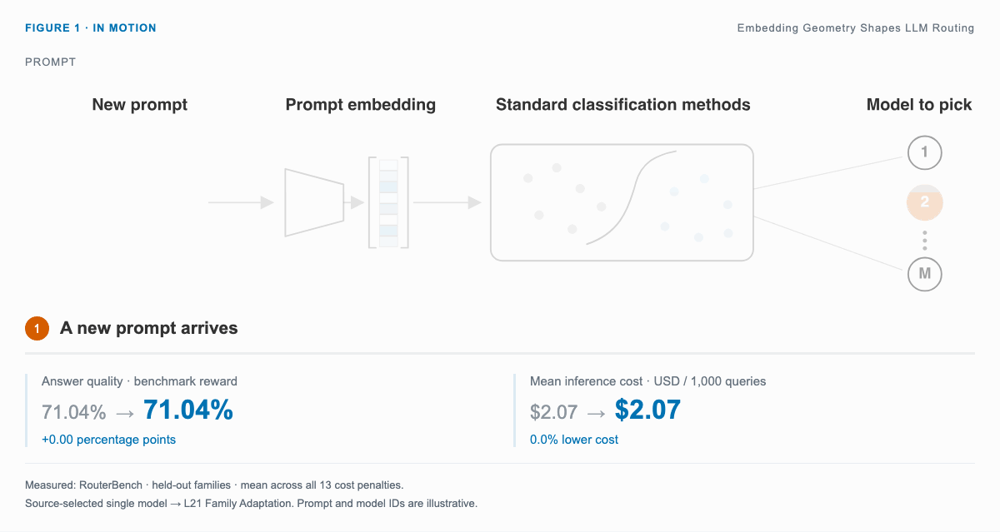
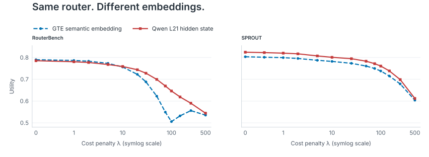

# Embedding Geometry Shapes LLM Routing

**The right model starts with the right representation.**

Turn each prompt into an embedding and route it to an LLM that balances quality and cost. Frozen Qwen hidden states help simple routers generalize to new task families.

**Leonardo Torti<sup>1,&#42;</sup> · Emanuele Rimoldi<sup>1,&#42;</sup> · Tomer Galanti<sup>2</sup> · Tomaso Poggio<sup>1</sup> · Pierfrancesco Beneventano<sup>1</sup>**

<sup>1</sup> Massachusetts Institute of Technology · <sup>2</sup> Texas A&M University

<sup>*</sup> Main contribution.

[Run the experiments](docs/EXPERIMENTS.md) · [Data](docs/DATA.md) · [Methods](docs/METHODS.md) · [Results & audit](docs/REPRODUCTION_AUDIT.md) · [Citation](CITATION.cff)

[](docs/demo/README.md)



With the same kNN-100 router, L21 raises mean held-out utility from 0.6615 to 0.7007 on RouterBench. On SPROUT, it rises from 0.7529 to 0.7731. The curves show every evaluated penalty, including the low-penalty region where GTE is slightly better on RouterBench.

In a separate comparison on RouterBench, L21 Family Adaptation raises mean reward from 71.04% to 74.63% versus a source-selected single model. Mean candidate-model inference cost falls from $2.07 to $1.55 per 1,000 queries.

## Reproduce

Check the bundled numerical evidence with Python 3.11; no GPU or external dependencies required:

```bash
git clone https://github.com/EmaRimoldi/routing-theory-reproducibility.git
cd routing-theory-reproducibility
python3 scripts/verify_release.py
python3 scripts/reproduce_results.py
python3 scripts/check_paper_results.py
```

For fresh data, embeddings and router training, follow the **[full execution guide](docs/RUN_COMMANDS.md)**. Public assets and environments are pinned; neural components require Linux and CUDA.

With Make installed, `make verify` runs the three checks above. See the [repository map](docs/STRUCTURE.md) and [versioned release guide](docs/RELEASE.md).

The audit passes 5,493 checks against the pinned manuscript reference and includes CPU/CUDA component runs. Full-scale fits and bootstraps have not all been independently rerun; see [coverage and limitations](docs/REPRODUCTION_AUDIT.md) and the [result index](docs/RESULT_INDEX.md).

Original project material uses **[CC BY 4.0](LICENSE)**, matching the paper's arXiv license. Third-party assets retain their own terms: [THIRD_PARTY.md](THIRD_PARTY.md).

After edits, refresh the export with `python scripts/build_submission.py` and commit its updated manifest.
