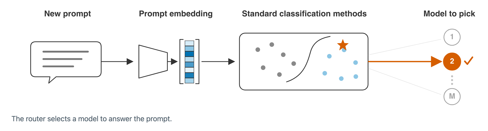

# Routing demo and embedding comparison

The animation reuses every original drawing object from Figure 1 of
[Embedding Geometry Shapes LLM Routing](https://arxiv.org/abs/2610.19198).
The source is Overleaf's `aistats_figures/intro_pipeline.pdf` at snapshot
`6e3bea88ec5d65de3587c0719025702e110ac3e0`. The unchanged PDF, font outlines,
colors, points, decision boundary, arrows and model symbols are preserved.
[provenance.json](provenance.json) records the source checksum and layer map.



## Automatic playback

The [GIF](routing-demo.gif) starts and repeats automatically in the GitHub README.
Open `docs/demo/index.html` from the cloned repository for the browser version:

```bash
open docs/demo/index.html  # macOS
```

It starts when visible and repeats after completing the prompt-to-model sequence.
There are no playback controls. The browser version uses a stationary final state
when the viewer requests reduced motion. The page and its local plots work offline.

The prompt, two-dimensional layout and model IDs illustrate the pipeline; this
explanation does not execute an LLM or predict a per-prompt performance improvement.

## What the comparison shows


The plot keeps kNN-100 fixed and changes only the embedding. Blue dashed circles
show GTE; red solid squares show Qwen L21. Each panel retains all 13 evaluated cost
penalties on the canonical held-out-family cohort. Lines connect point estimates
without smoothing; confidence intervals are not shown. Utility is reward minus
penalty times cost. The symlog horizontal axis includes zero and is linear between
zero and one, then logarithmic.

On RouterBench, mean utility increases from 0.6615 with GTE to 0.7007 with L21.
On SPROUT, it increases from 0.7529 to 0.7731. L21 improves average utility; the plot
also preserves GTE's slight advantage at low penalties on RouterBench.

[embedding-comparison-data.json](embedding-comparison-data.json) records every
plotted point, source selectors, unrounded means and source-file checksum.
The wide SVG/PNG and the stacked SVG use the same values. The browser selects the
stacked layout on narrow screens.

Plots use the Inter typeface, with a vector SVG and a 600-DPI PNG
(7200 × 2640 pixels). The animation and its poster render at twice the display
resolution. The optional builder fetches the font into `.cache/` on its first run;
its revision and checksum are in `../../manifests/readme_font.json`, and the license
is in `../INTER_FONT_LICENSE.txt`. Viewing the exported images needs no download.

The separate quality/cost sentences compare a source-selected single model with
L21 Family Adaptation on RouterBench. Mean reward rises from 71.04% to 74.63%, and
candidate-model inference cost falls from $2.07 to $1.55 per 1,000 queries.
These are arithmetic means over all 13 penalties, after pooling held-out queries
within each penalty. Reward includes graded tasks; cost excludes encoder/router
overhead. These are aggregate comparisons, not a guarantee for every prompt or
operating point. [demo-data.json](demo-data.json) retains their full precision.

All values are regenerated from the frozen
`results/evidence/baselines/_summary_reduced/scores.csv`.

## Rebuild

Optional authoring dependencies are separate from the experiment environment.
The initial font download uses `curl`; subsequent builds can use the verified cache.
Use Playwright 1.62.1, or select installed Chrome with `DEMO_BROWSER=chrome`.

```bash
python3.11 -m venv .venv-demo
.venv-demo/bin/pip install -r environment/demo-requirements.lock
npm install --prefix .cache/readme-demo playwright@1.62.1
.cache/readme-demo/node_modules/.bin/playwright install chromium

.venv-demo/bin/python scripts/build_readme_demo.py
NODE_PATH=.cache/readme-demo/node_modules node scripts/render_readme_demo.cjs
.venv-demo/bin/python scripts/build_readme_demo.py --gif
```

The builder decomposes the original PDF, recomputes the comparisons and redraws
the plots with Matplotlib. The renderer captures 108 frames over 10.8 seconds and
checks automatic start, completion, repeat, reduced motion and responsive layouts.
The [browser-check report](browser-check.json) records these executions. Intermediate
frames remain under `.cache/readme-demo/`. Renderer/font versions can affect raster
bytes; original vectors and numerical inputs have explicit hashes.

After edits, refresh the repository manifest and export:

```bash
python scripts/build_submission.py
python scripts/verify_release.py
```
